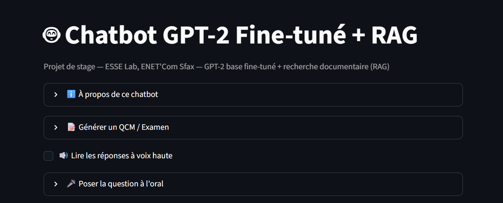
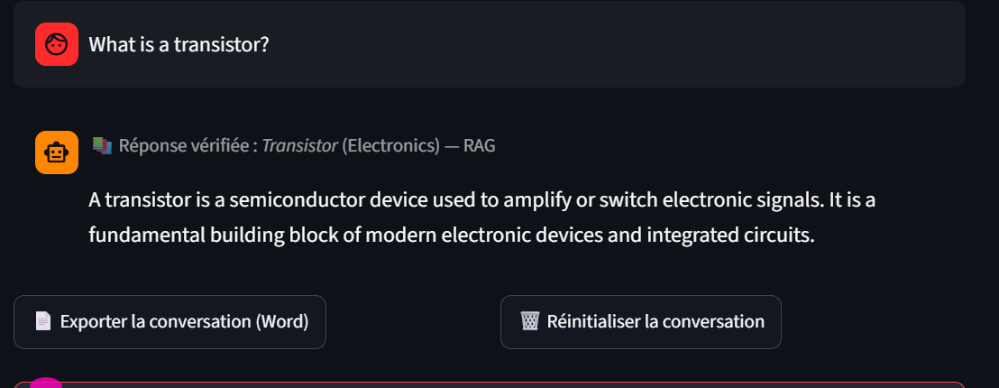
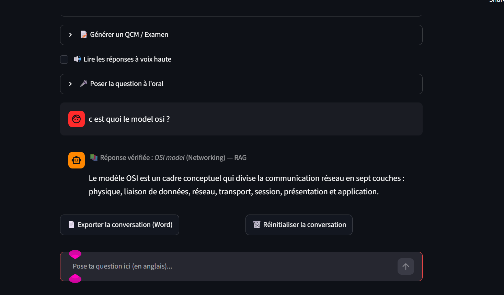
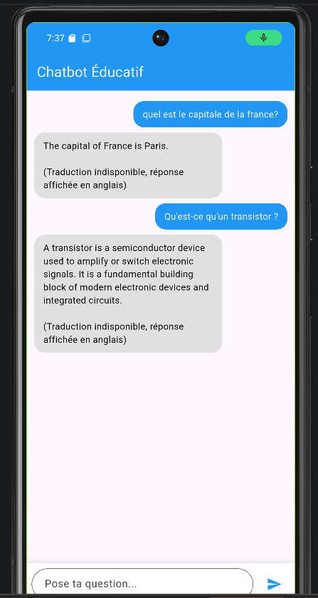

# 🎓 Educational Chatbot (RAG + GPT-2)

Chatbot éducatif bilingue (français / anglais) qui répond aux questions de cours grâce à une base de connaissances (RAG extractif) et à un modèle GPT-2 en solution de secours.

Projet réalisé dans le cadre d'un stage au laboratoire ESSE de l'ENET'Com (Sfax).

## 🚀 Démo en ligne

- Application : https://enetbot.streamlit.app/
- Remarque : l'hébergement est gratuit (Render), le premier chargement peut prendre 30 à 60 secondes le temps que le serveur se réveille.

## 📸 Captures d'écran


### Page d'accueil

*Interface du chatbot : l'utilisateur écrit sa question en français ou en anglais dans la zone de saisie.*

### Réponse issue de la base de connaissances (RAG)

*Le chatbot retrouve la réponse la plus proche dans sa base de connaissances grâce à TF-IDF et à la similarité cosinus.*

### Support multilingue

*La même question posée en français et en anglais : le chatbot détecte la langue et répond dans celle de l'utilisateur.*

### Application mobile (Flutter)

*Interface de l'application Flutter : elle se connecte à l'API FastAPI hébergée sur Render et affiche les mêmes réponses que la version web.*

## ✨ Fonctionnalités

- Réponses issues d'une base de connaissances de plus de 350 entrées couvrant plus de 30 matières (TF-IDF + similarité cosinus)
- Support multilingue français / anglais (traduction automatique avec deep-translator, repli sur MyMemory)
- Calculs arithmétiques intégrés
- Dictionnaire des capitales
- Repli sur GPT-2 (via l'API Hugging Face Inference) quand la base ne contient pas la réponse
- API REST (FastAPI) et interface web

## 🧠 Comment ça marche

- La question est détectée puis traduite en anglais si besoin
- Le système cherche la réponse la plus proche dans la base de connaissances (TF-IDF + similarité cosinus)
- Si aucune réponse assez proche n'est trouvée, GPT-2 génère une réponse (moins fiable)
- La réponse est retraduite dans la langue de l'utilisateur

## 🗂️ Structure du projet

- `app.py` : interface Streamlit et logique principale (RAG, traduction, calculatrice, capitales)
- `api.py` : serveur FastAPI qui expose le chatbot via HTTP
- `knowledge_base.py` : base de connaissances du RAG
- `static/` : fichiers statiques de l'interface web
- `requirements.txt` : dépendances de l'application Streamlit
- `requirements_api.txt` : dépendances de l'API
- `runtime.txt` : version de Python pour le déploiement
- `.devcontainer/` : configuration du conteneur de développement

## 🛠️ Technologies

- Python 3.11
- Streamlit, FastAPI
- scikit-learn (TF-IDF, similarité cosinus)
- GPT-2 via Hugging Face Inference API
- deep-translator, rapidfuzz
- Déploiement : Render, Streamlit Community Cloud, Hugging Face Hub

## ▶️ Lancer en local

```bash
git clone https://github.com/aichaghouma/educational-chatbot-gpt2.git
cd educational-chatbot-gpt2
pip install -r requirements.txt
streamlit run app.py
```

Pour lancer l'API :

```bash
pip install -r requirements_api.txt
uvicorn api:app --reload
```

## 🔮 Perspectives

- Application mobile Flutter (version Android déjà testée)
- Enrichissement de la base de connaissances
- Amélioration de la qualité des réponses de secours

## 👩‍💻 Auteure

**Aicha Ghouma** — Étudiante ingénieure, ENET'Com Sfax
GitHub : (https://github.com/aichaghouma)
